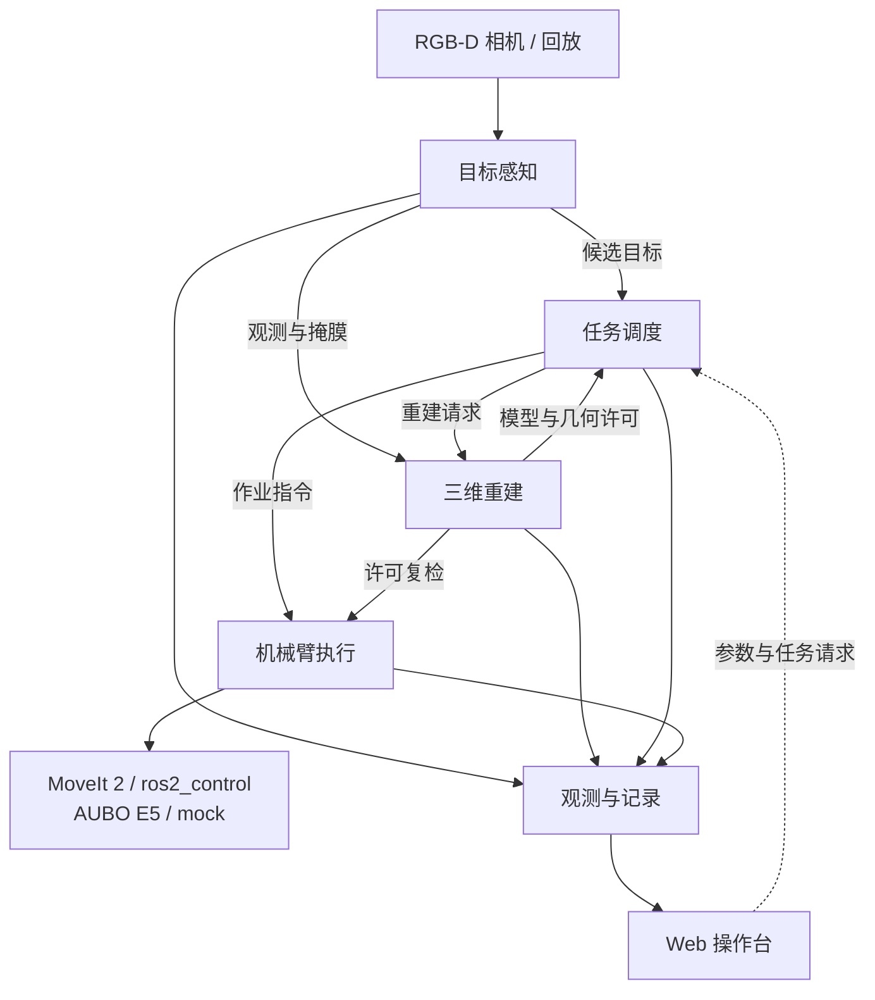
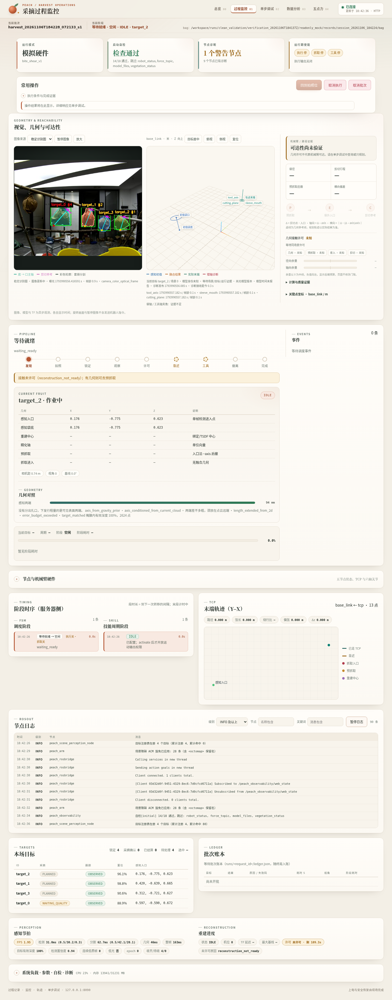

# Peach Robot

基于 **ROS 2 Jazzy** 的 **AUBO E5 套袋桃采摘系统**。

Peach Robot 面向固定作业点，将 RGB-D 目标感知、逐果三维重建、任务调度、机械臂执行与 Web 操作台连接起来。你可以用随仓库提供的图像和点云回放数据，在 mock 机械臂上查看感知结果、调试采摘流程，并分析每颗目标的模型、轨迹和作业记录。

[快速开始](#快速开始) · [系统架构](#系统架构) · [使用文档](docs/README.md) · [版本下载](https://github.com/MUHAN11-c/peach_robot/releases)

## 主要能力

- **目标感知**：结合 YOLO 检测、FastSAM 分割和 RGB-D 几何，提取套袋目标、袋轴与入口信息，并维护跨帧目标身份。
- **逐果重建**：按目标融合多帧观测，进行 TSDF 重建与几何精化，输出目标模型和带身份、时效的几何许可。
- **采摘编排**：通过批次状态机组织拍照、选果、重建和执行，支持暂停、跳过、取消与人工恢复确认，记录逐果结果。
- **机械臂执行**：基于 MoveIt 2 与 ros2_control，处理预抓取、沿轴套入、工具动作和撤退；执行前复核模型与使能条件。
- **可视化与记录**：五页 Web 操作台提供总览、过程监控、参数调试、历史分析和五点力观测；ROS 诊断、会话录包与任务账本用于追溯。

## 系统架构



感知、重建、调度和执行是独立 ROS 2 能力，通过话题、服务、Action 与 TF 协作。调度根据目标观测选果，臂侧在执行前再次核验几何许可。五点力用于观测与记录。

模块职责和接口细节见[整栈架构](src/peach/peach_bringup/doc/architecture.md)与[接口清单](src/peach/peach_interfaces/config/interface_manifest.yaml)。

## 快速开始

### 1. 安装与构建

使用 **Ubuntu 24.04 amd64**。部署脚本安装 ROS 2 Jazzy、Python 3.12 环境及 Node.js，默认使用 CPU 版 PyTorch，构建 ROS 包和浏览器资源。工作区路径使用无空格的英文路径，`--system` 需要 root/sudo。

```bash
git clone https://github.com/MUHAN11-c/peach_robot.git
cd peach_robot
bash scripts/deployment/deploy.sh --system --verify --jobs 2
```

仓库包含 Peach 模型与最小 RGB-D 回放数据。`--verify` 运行使能关闭的 mock 检查，并在结束后停止测试栈。更多安装方式、依赖和隔离环境说明见[部署指南](scripts/deployment/README.md)。

### 2. 使用示例数据预览

在工作区根目录打开新终端，加载环境并启动冻结回放。该入口使用 mock 机械臂与自带 RGB-D 静态帧，无需机器人或相机。

```bash
source scripts/deployment/env.bash
pgrep -af 'ros2 launch|ros2_control_node|move_group|frozen_camera_replay' || true
ros2 launch peach_system_tests frozen_camera_grasp.launch.py \
  bag:="$PWD/runs/data/delivery_simulation_20261106/rgbd_frame_bag" \
  frame_index:=0 hz:=2 rviz:=false
```

启动前确认没有既有采摘栈占用本轮资源。就绪后访问 **[http://127.0.0.1:8090](http://127.0.0.1:8090)** 查看操作台。回放入口默认不发起采摘任务，执行、抓取和工具使能关闭；结束时在启动终端按 `Ctrl+C`，等待录包封口与进程退出。

### 3. 调试与开发

- 调整参数、查看图像和模型、操作单轮任务：阅读 [Web 使用手册](src/peach/peach_web/doc/debug-testing.md)。
- 执行工具关闭的单果干跑、复核账本和清理进程：阅读[系统测试指南](src/peach/peach_system_tests/doc/testing.md)。
- 使用无相机 mock、接入相机或配置应用启动：阅读 [bringup 说明](src/peach/peach_bringup/README.md)。

<details>
<summary>查看 Web 过程监控界面（mock 回放示例）</summary>



</details>

## 项目结构

| 目录 | 内容 |
|---|---|
| [`src/peach/`](src/peach/peach_bringup/doc/architecture.md) | 感知、重建、调度、执行、场景、接口、观测、Web 与整栈组合 |
| `src/aubo_*` | AUBO 消息、机器人模型、硬件接口、控制器和 MoveIt 配置 |
| [`src/percipio_camera/`](src/percipio_camera/README.md) | Percipio 相机驱动；应用另提供 `peach_stereo` 立体深度前端 |
| [`src/aubo_hand_eye_calibration/`](src/aubo_hand_eye_calibration/README.md) · [`src/serial_force/`](src/serial_force/README.md) | 相机标定与五点力传感工具 |
| [`src/ros2_web_link/`](src/ros2_web_link/README.md) | 浏览器 ROS 通信 SDK 与 ROSbridge 集成 |
| [`src/ivg/`](src/ivg/README.md) · [`src/peach_sim/`](src/peach_sim/README.md) | 独立演示栈与仿真子工作区 |
| [`scripts/deployment/`](scripts/deployment/README.md) | 环境安装、构建与 mock 验证 |
| [`runs/data/delivery_simulation_20261106/`](runs/data/delivery_simulation_20261106/README.md) | 最小回放 bag、图像样例与数据来源 |
| [`docs/`](docs/README.md) | 架构专题、接口说明、开发决策和版本记录 |

## 文档

- [文档索引](docs/README.md)：按主题了解系统和各能力包。
- [数据流](docs/architecture/02-runtime-flow.md)与[包依赖](docs/architecture/01-package-graph.md)：理解节点间的数据与请求关系。
- [打包与迁移](README_PACKAGE.md)：恢复完整交付包或生成自己的源码包。
- [版本说明与已知限制](docs/releases/v1.0.0.md)：查看支持范围和验证依据。

## 项目状态

当前版本的验收范围为 **Ubuntu 24.04 amd64 CPU 的 mock / 冻结回放**。真实硬件、真实剪切、原生 WS 网页抓取、Orin 与长期稳定性仍需分别验证；Gazebo 子工作区暂停运行。硬件作业需要操作员授权，默认关闭自动开批及执行、抓取、工具使能。

## 许可证

项目许可见 [LICENSE](LICENSE)。共享 SDK 与第三方组件遵循各自的许可和分发条件，详见对应目录中的声明。
